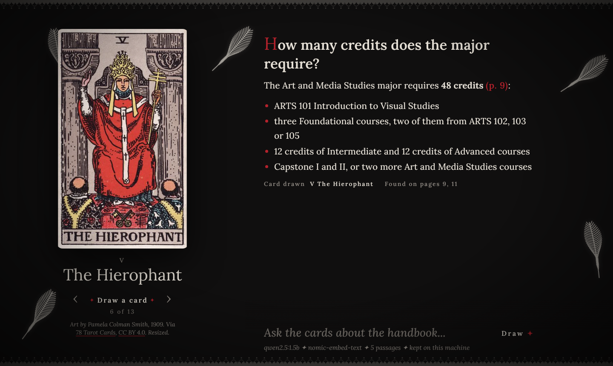

# Local RAG Chatbot for the FUV Art & Media Studies Major Handbook

CS311 Advanced Deep Learning, Fall 2026, final project.

A Retrieval-Augmented Generation (RAG) system that runs entirely on your own computer.
It reads PDF and TXT documents, stores their embeddings in ChromaDB, and answers
questions with a local LLM served by Ollama. The main knowledge source is the
**B.A. Art & Media Studies (AMS) Major Handbook** of Fulbright University Vietnam.



## Features

| Task | What was built | Where |
|---|---|---|
| 1. PDF support | PDF and TXT loading, page-level metadata, text cleaning for broken PDF glyphs | `source_code/rag/loaders.py` |
| 2. Handbook chatbot | RAG pipeline with cosine retrieval, relevance filter, grounded prompt, page citations, follow-up questions; 20-question evaluation script | `source_code/rag/pipeline.py`, `source_code/eval/` |
| 3. Docker | Dockerfile + Compose stack (Ollama, model download, web app) with volumes | `docker/` |
| 4. Web UI | Flask app in a tarot style: 78-card deck that shuffles and draws a card per question, Noir and Vellum themes, streamed answers, conversation history, source excerpts | `source_code/app.py`, `templates/`, `static/` |

Improvements over the baseline `run_txt.py`:

1. **PDF support with page numbers**, so answers can cite "(p. 7)".
2. **Automatic re-indexing.** The baseline reused an old vector store forever, even after new files were added. Now a fingerprint of the files and chunk settings is saved; any change triggers a rebuild.
3. **Cosine similarity** instead of L2 distance, so scores are in 0..1 and a threshold is meaningful.
4. **Per-chunk filtering** instead of averaging all scores (one strong chunk is no longer dragged down by four weak ones).
5. **Grounded answers.** The model must answer only from the handbook and say "I could not find this in the handbook." otherwise, instead of falling back to general knowledge.
6. **Conversation memory** for follow-up questions such as "what are its prerequisites?".
7. **Text repair** for PDF extraction errors: words split by a stray space (`s tudents`, `c urriculum`, `als o`) are re-joined using the document's own vocabulary, and heading fonts that extract "ti" as `;` or `8` are fixed (`Descrip;on` becomes `Description`).
8. **Scope guard** (`rag/scope.py`). The vector search always returns the 5 closest chunks, and the handbook is
   full of "credits" and "requirements", so "How many credits does Maths require?" scored as high as a real AMS
   question and the model answered with AMS numbers. Now: a question naming another subject (Mathematics,
   Computer Science, Economics, ...) without mentioning AMS is declined; a question whose best passage is below
   `SCOPE_THRESHOLD` is declined; between `SCOPE_THRESHOLD` and `SCOPE_CONFIRM` the LLM makes a yes/no call.
9. **nomic-embed-text task prefixes** (`search_query:` / `search_document:`), which the model was trained with.
   Unrelated questions now score clearly lower than handbook questions.
10. **Headings carried into chunks.** A chunk cut below its heading lost its meaning: ARTS 309's prerequisites sit
    on the next page, so the bot answered with ARTS 308's. Chunks that continue a course or section now start with
    e.g. `[ARTS 309: Advanced Narrative Film Production, continued]`, and each requirement block starts a new chunk.
11. **Better conversation memory.** Follow-ups ("how often is it offered?") are rewritten with the previous question
    and its course code; a follow-up to an out-of-scope question stays out of scope; "What about AMS then?" after a
    declined Maths question keeps the topic ("credits to graduate") but drops the subject; declined answers are not
    fed back to the model as conversation.
12. **Grounding check for numbers.** Any number in an answer that appears in none of the retrieved passages (or the
    question) is flagged under the answer, because invented figures are the most harmful mistake for a handbook bot.

## Project structure

```
ADL-project/
├── source_code/
│   ├── app.py              # Task 4: Flask web server
│   ├── cli.py              # terminal chat (Task 1 and 2 demos)
│   ├── rag/
│   │   ├── config.py       # all settings, overridable by environment variables
│   │   ├── loaders.py      # Task 1: TXT + PDF loading and cleaning
│   │   ├── pipeline.py     # Task 2: indexing, retrieval, prompt, generation
│   │   └── mock.py         # fake backend for UI work without Ollama
│   ├── templates/index.html
│   ├── static/             # style.css, app.js, arts.js (built-in cards), fonts/, tarot/ (card images)
│   ├── tarot.py            # reads static/tarot/ and sorts the 78 cards
│   ├── scripts/            # get_fonts.py, export_figma_cards.py
│   ├── eval/
│   │   ├── questions.json  # 20 test questions with expected answers and pages
│   │   └── run_eval.py     # runs them against one or more models
│   ├── data/
│   │   ├── handbook/       # AMS_MajorHandbook.pdf (Task 2)
│   │   └── test_pdf/       # any PDF for the Task 1 demo
│   └── requirements.txt
├── docker/
│   ├── Dockerfile
│   └── docker-compose.yml
├── report/
└── demo_video/
```

## Option A: run locally

**1. Install Ollama and pull the models**

```bash
# https://ollama.com/download
ollama serve                       # skip on macOS if the Ollama app is open
ollama pull nomic-embed-text
ollama pull qwen2.5:1.5b           # also try qwen2.5:0.5b and qwen2.5:3b
```

**2. Create the Python environment**

```bash
conda create -n rag python=3.10
conda activate rag
cd source_code
pip install -r requirements.txt
```

**3. Use it**

```bash
# Web interface (Task 4), then open http://127.0.0.1:8000
python app.py

# Terminal, one question
python cli.py -q "What are the prerequisites for ARTS 309?"

# Terminal, interactive chat with follow-ups
python cli.py

# Task 1: any other PDF folder, with its own vector store
python cli.py --data-dir data/test_pdf --store vector_store/test_pdf -q "How much is the Docker task worth?"

# Another model
python cli.py --model qwen2.5:3b -q "What GPA do I need for the Capstone?"
```

The first run builds the vector store in `vector_store/`. Later runs load it in seconds.
Add or change a file in `data/handbook/` and the index rebuilds automatically.

## Option B: run with Docker

Requires Docker Desktop (or Docker Engine + Compose v2).

```bash
cd docker
docker compose up --build
```

Then open <http://localhost:8000>. Compose starts three services:

| Service | Role |
|---|---|
| `ollama` | Ollama server, models stored in the `ollama_models` volume |
| `ollama-init` | pulls `nomic-embed-text` and the LLM once, then exits |
| `app` | the chatbot; `source_code/data` is mounted read-only, the index lives in the `vector_store` volume |

Useful commands:

```bash
LLM_MODEL=qwen2.5:3b docker compose up          # another model
docker compose logs -f app                      # watch indexing and requests
docker compose exec app python cli.py -q "Which courses need ARTS 104?"
docker compose exec app python -m eval.run_eval # evaluation inside the container
docker compose down                             # stop (add -v to delete models and index)
```

**macOS note.** Docker on macOS cannot use the Apple GPU, so Ollama in a container is slow.
For a faster demo, keep Ollama running natively and run only the app container:

```bash
docker build -f docker/Dockerfile -t handbook-rag ./source_code
docker run --rm -p 8000:8000 -e OLLAMA_URL=http://host.docker.internal:11434 handbook-rag
# Linux: add --add-host=host.docker.internal:host-gateway
```

## Configuration

Every setting in `rag/config.py` can be set as an environment variable.

| Variable | Default | Meaning |
|---|---|---|
| `DATA_DIR` | `data/handbook` | folder of `.pdf` / `.txt` files to index |
| `VECTOR_STORE` | `vector_store/handbook` | where Chroma saves the index |
| `LLM_MODEL` | `qwen2.5:1.5b` | Ollama model that writes the answer |
| `EMBED_MODEL` | `nomic-embed-text` | Ollama embedding model |
| `CHUNK_SIZE` / `CHUNK_OVERLAP` | `800` / `150` | characters per chunk / shared characters |
| `TOP_K` | `5` | chunks retrieved per question |
| `SCORE_THRESHOLD` | `0.35` | minimum cosine similarity for a chunk to be used |
| `SCOPE_THRESHOLD` | `0.60` | if the best chunk is below this, the question is declined as outside the handbook |
| `SCOPE_CONFIRM` | `0.68` | between the two thresholds the LLM decides (yes/no) whether the question is about the handbook |
| `TEMPERATURE` | `0.1` | low for factual answers |
| `HISTORY_TURNS` | `2` | previous Q/A pairs given to the model |
| `OLLAMA_URL` | `http://127.0.0.1:11434` | Ollama server |

## Evaluation (Task 2)

```bash
cd source_code
python -m eval.run_eval --models qwen2.5:0.5b qwen2.5:1.5b qwen2.5:3b
```

This asks all 20 questions in `eval/questions.json` (program requirements, course offerings,
learning outcomes, policies, careers, student life, three questions where the handbook is
contradictory or incomplete, and one question it cannot answer) and writes `eval/results/results.md` with, for each answer:
whether the expected page was retrieved, a keyword score, the time taken, and an empty
**Verdict** column to mark by hand as Correct, Incorrect, Incomplete or Ambiguous.

### Out-of-scope test (does the bot decline other majors?)

```bash
cd source_code
python -m eval.run_scope_eval                  # baseline vs. guarded pipeline
python -m eval.run_scope_eval --skip-baseline  # guarded only, faster
```

`eval/out_of_scope.json` holds 25 real questions answered by the **Applied Mathematics** and **Computer Science**
handbooks (provided in the course's sample code), each with its true answer and page. Many are shaped exactly like
AMS questions ("How many credits does the CS major require?" — 56, while AMS is 48), plus course codes only
(`CS201`, `MATH 205`), course names only ("Real Analysis"), and conversations that drift from AMS to another major.
The AMS bot must decline all of them. Controls check that the guard is not too strict: 5 AMS questions that mention
another subject ("Can I take ARTS 313 if I completed SOCI 102?") and the 20 AMS evaluation questions must be
answered. The *baseline* mode runs the same index and model without the scope guard and with the original prompt,
showing what the bot did before the fix. Results: `eval/results/scope_results.md`.

## The interface

The page is a Victorian tarot reading table in black (or vellum), bone white and rose red: a faint rose
damask wallpaper, a double-ruled frame with rose sprays (rose, bud, thorny stems, leaves) in the corners,
roses on the card's mount, a few falling petals, and a copperplate script title (Pinyon Script). The hero
names the three areas of the major from the Fulbright AMS page: art history and curating, film and media
studies, visual and performing arts. The reading (the conversation) has no boxes or bubbles; declined
(out-of-scope) answers are set in muted italics with a red petal.

* **Tarot deck** (left side): browse with ‹ and › (or the arrow keys), or press "Draw a card".
  Each question shuffles the deck (the card turns to its back) and draws a card at random when
  the answer is ready; the drawn card is noted under the answer.
* **The 78 cards:** the Rider-Waite-Smith deck from the Figma file
  [78 Tarot Cards](https://www.figma.com/community/file/1276447799586098149/78-tarot-cards).
  13 cards were exported through the Figma MCP server; `python scripts/export_figma_cards.py --token ...`
  exports the rest with the Figma REST API (steps in `static/tarot/README.txt`).
  The app recognises card names, sorts them into deck order and shows numeral and title.
* **Fonts:** Pinyon Script (titles), Cormorant SC (labels) and Cormorant Garamond (text),
  all Open Font License, loaded from Google Fonts. Run `python scripts/get_fonts.py` once to save
  them in `static/fonts/` so the page also works offline; Lora (bundled) is the last fallback.
* **Themes:** Noir and Vellum, switch in the top bar. Choice of theme, current card and the
  conversation are remembered in the browser.

**Card art credit.** The card images are the Rider-Waite-Smith tarot deck, illustrated by
Pamela Colman Smith (A. E. Waite, Rider & Co., 1909; the original artwork is in the public domain),
taken from ["78 Tarot Cards"](https://www.figma.com/community/file/1276447799586098149/78-tarot-cards)
by [creator name] on Figma Community, licensed under [CC BY 4.0](https://creativecommons.org/licenses/by/4.0/).
They were exported from Figma, converted to WebP and resized; the artwork itself is unchanged.
The same credit appears in the interface under the card (set `TAROT_AUTHOR` in `rag/config.py`)
and in `static/tarot/ATTRIBUTION.txt`.

## Working on the interface without Ollama

```bash
MOCK=1 python app.py
```

Returns a fixed sample answer, so the page can be styled without waiting for a model.

## Known limitations

* Text inside images is not extracted (no OCR). The AMS handbook is text-based, so this does not affect it.
* Tables are flattened into lines of text. Questions whose answer is spread over many pages
  (for example "which courses have a materials fee?") are often incomplete, because only the top 5 chunks are used.
* Split words that appear only once in the handbook (`increasing ly`) cannot be repaired without a dictionary.
* The handbook sometimes disagrees with itself: for ARTS 305 and ARTS 307 the course catalogue table and the
  course description list different prerequisites, and the cover has a "MAJOR CODE" label with no code.
  The bot can only be as consistent as its source.
* Page numbers are the PDF page index (what a PDF viewer shows), one more than the number printed on the page.
* Small models (0.5b, 1.5b) sometimes ignore the "answer only from the context" instruction, mix up course codes,
  or combine correct numbers wrongly (e.g. "48 credits, including 40 general and 8 major"). The number check only
  catches figures that are not in the passages at all. `qwen2.5:3b` is noticeably more reliable.
* The scope guard's subject list is hand-written (`OTHER_SUBJECTS` in `rag/scope.py`); a subject not in the list
  falls through to the similarity and LLM checks.
* One vector store per process; the web app serves one document collection at a time.

## Acknowledgements

* Tarot cards: Rider-Waite-Smith deck by Pamela Colman Smith (1909, public domain), via "78 Tarot Cards" by [creator name], Figma Community, [CC BY 4.0](https://creativecommons.org/licenses/by/4.0/).
* Fonts: Pinyon Script, Cormorant SC, Cormorant Garamond and Lora, all SIL Open Font License.

Baseline code and handbooks provided by the CS311 course (Fulbright University Vietnam).
Built with [Ollama](https://ollama.com), [LangChain](https://python.langchain.com), [ChromaDB](https://www.trychroma.com), [pypdf](https://pypdf.readthedocs.io) and [Flask](https://flask.palletsprojects.com).
